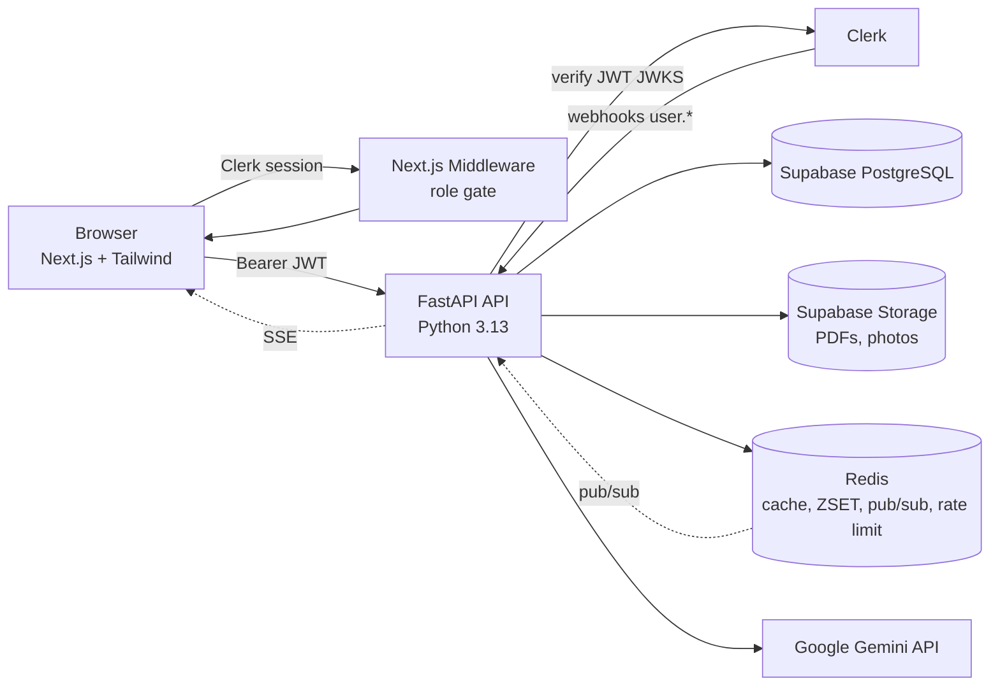
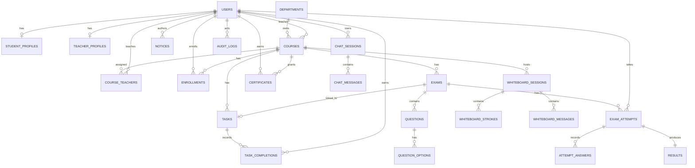
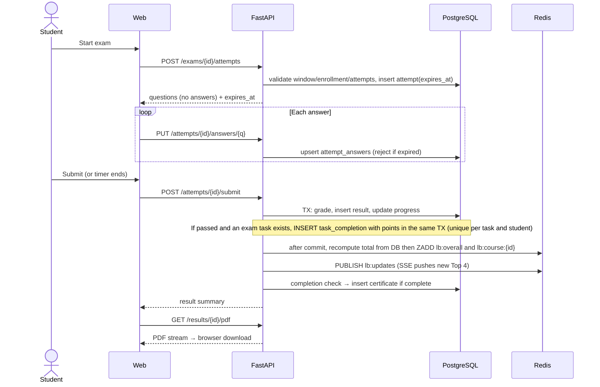
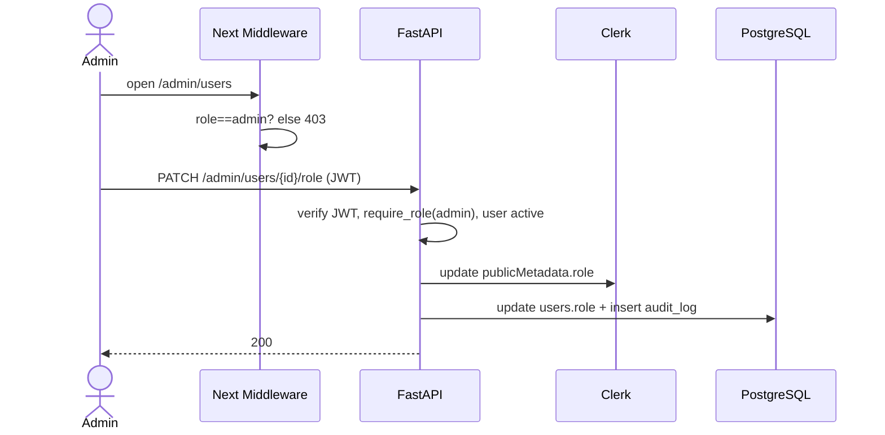
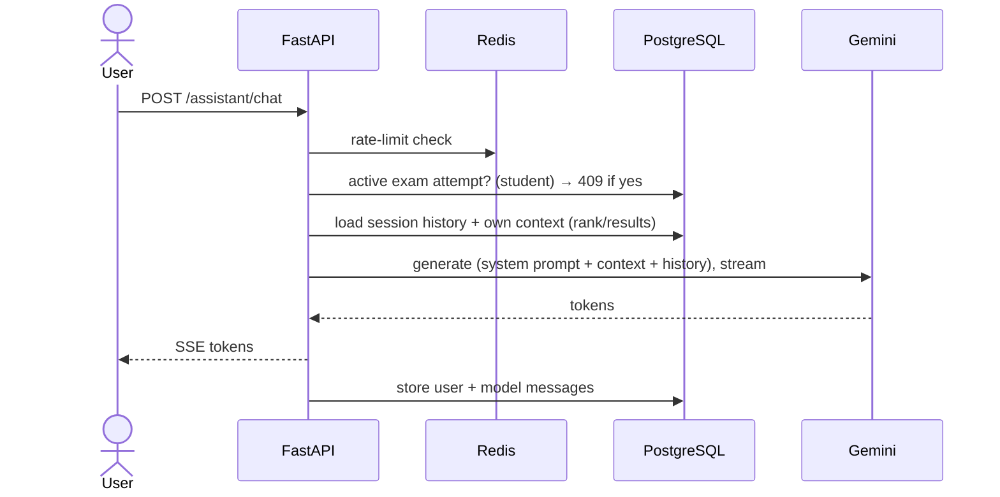
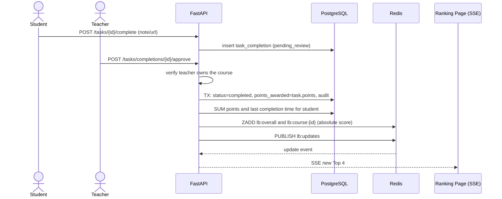

# System_Design.md — SiliconBrains University (HLD + LLD)

## 1. Overview
**Purpose:** SiliconBrains University is a role-based (Student/Teacher/Admin) learning platform for online exams, generated results and certificates, live ranking, notices, and an AI assistant (Aarsh Intelligence).

**Goals**
- Secure, server-authoritative exam lifecycle (exam → result → certificate).
- Verifiable PDFs generated in the backend and downloaded from the frontend.
- Live Top-4 leaderboard driven by **Task Points** awarded automatically on task completion, plus admin live analytics.
- Strong RBAC with hardened admin routes.

**Non-goals (MVP):** payments, video lessons, proctoring, email/SMS, multi-tenancy, native apps, descriptive/coding questions.

## 2. Requirements
### Functional
- Clerk auth with 3 roles; admin-controlled role assignment.
- Landing, Student/Teacher dashboards, Virtual ID Card, Exam, Result, Certificate, Tasks & Task Points, Live Ranking, Notice Board, AI chat.
- Admin: user control, progress check, live analytics, notice control.
- Result and certificate PDFs generated server-side.

### Non-functional
| Area | Target |
|---|---|
| Read API latency | p95 < 300 ms |
| Leaderboard latency | < 50 ms (Redis) |
| Exam submit | p95 < 800 ms incl. grading |
| Availability | 99.5% (MVP) |
| Scalability | 5k users, 500 concurrent exam takers |
| Security | JWT verified on every call, RBAC + ownership, rate limiting, audit |
| Data durability | Daily backups, PITR if available |

## 3. Assumptions & Constraints
- Python 3.13 (from "python13.3"). MCQ single-answer exams. No lessons: progress = published exams passed. Ranking = total Task Points (fixed per task; exam tasks auto-complete on pass, assignment tasks need teacher approval; tie-break = earliest to reach total; exam marks do not affect rank).
- Expected scale ≈ 5,000 users, ≈ 500 concurrent exam takers, < 50 req/s average, bursts ≈ 300 req/s at exam start/end. **(assumed)**
- Budget-conscious: managed services (Vercel, Supabase, Upstash-type Redis, container PaaS).
- Gemini API quota/latency are external constraints.
- Team size unspecified; modular monolith chosen to keep ops simple.

## 4. High-Level Architecture
**Style:** Modular monolith (FastAPI) behind a Next.js frontend. *Why:* single deployable, easy transactions (grading + result + certificate), low ops cost, clear module boundaries allow later extraction of AI/PDF into services.



## 5. Component Design
| Component | Responsibility | Interfaces | Dependencies | Tech |
|---|---|---|---|---|
| Web App | UI, routing, role gate, PDF download, SSE client | REST/SSE to API; Clerk SDK | API, Clerk | Next.js, Tailwind |
| Auth module | JWT verify, `get_current_user`, `require_role`, webhook sync | `deps.py`, `/webhooks/clerk` | Clerk JWKS, DB, Redis (JWKS cache) | PyJWT, svix |
| User service | Profiles, roles, status, ID card data | `/me`, `/admin/users` | DB, Clerk API | FastAPI, SQLAlchemy |
| Course service | Courses, enrollments, progress, teacher assignments | `/student/courses`, `/admin/courses/*`, `/admin/enrollments` | DB | — |
| Exam service | Exam CRUD, attempts, timer, autosave, grading | `/exams`, `/attempts` | DB, Task svc, Certificate svc | — |
| Task service | Tasks CRUD, completions, approval queue, **automatic point awarding** (same transaction), revoke | `/tasks`, `/student/points`, `/admin/tasks/*` | DB, Ranking svc, Audit svc | — |
| Result service | Results, review, PDF trigger | `/results` | DB, PDF svc, Storage | — |
| PDF service | Render result & certificate PDFs, QR codes | internal `render_result_pdf`, `render_certificate_pdf` | Storage | ReportLab, qrcode |
| Certificate service | Completion check, issue, revoke, verify | `/certificates`, `/public/verify/*` | DB, PDF svc | — |
| Ranking service | Recompute student's Task Points → absolute ZADD, top-4, my rank, SSE broadcast, rebuild/reconcile | `/ranking/*` | Redis, DB (`task_completions`) | redis-py |
| Notice service | Notice CRUD, audience filtering, cache | `/notices` | DB, Redis | — |
| AI service | Prompting, safety checks, Gemini streaming, history | `/assistant/*` | Gemini, DB, Redis | google-genai |
| Analytics service | Aggregates for admin, SSE refresh | `/admin/analytics/*` | DB, Redis | — |
| Audit service | Immutable admin action log | internal | DB | — |
| Whiteboard service | Course session lifecycle, stroke sync, undo/clear, join, expiring chat | `/whiteboard/*` | DB, active course membership | — |

## 6. Data Design
### ER Diagram

(Full column-level detail in `database.md`.)

**Database choice:** PostgreSQL (Supabase) — relational integrity fits users/courses/exams/results; strong constraints, transactions for grading; managed backups.

**Caching:** Redis — leaderboard ZSETs, notice lists (60 s), public stats (5 min), analytics (30–60 s), JWKS (1 h), rate limits.
**Indexing:** FK indexes, `(exam_id, score DESC, time_taken_sec)`, partial index on in-progress attempts, `(student_id, status)` and `UNIQUE (task_id, student_id)` on task_completions, `(status, published_at DESC)` for notices.
**Retention:** results/certificates retained indefinitely; chat messages 180 days (configurable); audit logs ≥ 1 year; expired notices archived; PDFs cached in Storage (regenerable except certificates, which are kept).

## 7. API Design
Base `/api/v1`, JSON, `Authorization: Bearer <Clerk JWT>`. Versioned by path (`/v1`). Errors: `{ "error": { "code", "message", "details" } }`.

**Start attempt**
```http
POST /api/v1/exams/{exam_id}/attempts
→ 201 { "attempt_id": "uuid", "expires_at": "2026-10-20T10:30:00Z",
        "questions": [ { "id": "uuid", "text": "...", "marks": 2,
                         "options": [ { "id": "uuid", "text": "..." } ] } ] }
```
**Autosave answer**
```http
PUT /api/v1/attempts/{attempt_id}/answers/{question_id}
{ "selected_option_id": "uuid" }
→ 200 { "saved": true, "server_time": "..." }
```
**Submit**
```http
POST /api/v1/attempts/{attempt_id}/submit
→ 200 { "result_id": "uuid", "score": 18, "total_marks": 20, "percentage": 90,
        "passed": true, "grade": "A+", "rank_in_exam": 2,
        "task_points_awarded": 50 }
```
**Download result PDF**
```http
GET /api/v1/results/{result_id}/pdf
→ 200 application/pdf  (Content-Disposition: attachment; filename="result-<code>.pdf")
```
**Top 4 ranking**
```http
GET /api/v1/ranking/top?scope=overall
→ 200 { "updated_at": "...", "items": [ { "rank": 1, "user_id": "uuid",
        "name": "A. Sharma", "avatar_url": "...", "points": 250, "tasks_completed": 7 } ] }
```
**Complete an assignment task (student)**
```http
POST /api/v1/tasks/{task_id}/complete   { "note": "Report attached", "url": "https://..." }
→ 202 { "completion_id": "uuid", "status": "pending_review" }
```
**Approve (teacher of that course / admin) — points awarded automatically**
```http
POST /api/v1/tasks/completions/{completion_id}/approve   { "review_note": "Good work" }
→ 200 { "status": "completed", "points_awarded": 40, "student_total_points": 290 }
```
**Student points**
```http
GET /api/v1/student/points
→ 200 { "total_points": 290, "tasks_completed": 8, "rank": 3,
        "history": [ { "task": "Lab report 2", "points": 40, "completed_at": "..." } ] }
```

**Chat (stream)**
```http
POST /api/v1/assistant/chat   { "session_id": "uuid|null", "message": "Explain normalization" }
→ 200 text/event-stream  (tokens) ; 409 if student has an active exam attempt
```
**Admin role change**
```http
PATCH /api/v1/admin/users/{id}/role   { "role": "teacher" }   (admin only)
→ 200 { "id": "uuid", "role": "teacher" }
```
**Auth:** all endpoints except `/public/*` and `/webhooks/clerk` (Svix-signed) require a valid JWT.

## 8. Key Workflows
### 8.1 Exam attempt → result → Task Points → ranking → certificate

### 8.2 Role-protected admin action

### 8.3 Aarsh Intelligence chat


### 8.4 Assignment task → approval → automatic points → live ranking


## 9. Scalability & Performance
| Bottleneck | Mitigation |
|---|---|
| Exam start/end bursts | Stateless API replicas (2+), connection pooler (Supabase pgbouncer), lightweight autosave upserts |
| Leaderboard reads | Redis ZSET; SSE fan-out via pub/sub, throttle broadcasts to ≤ 1/2 s |
| Notice/analytics reads | Redis cache with short TTL + invalidation |
| PDF generation CPU | Generate once, cache in Storage; run in threadpool/background; certificates immutable |
| Gemini latency/quota | Streaming, per-user rate limit, timeouts, circuit breaker |
| DB growth (`attempt_answers`) | Indexes; partition by exam/year later if needed |
Load balancing: platform LB over API replicas. Queues: not needed in MVP (FastAPI BackgroundTasks); add Celery/RQ if PDF/AI load grows. Sharding not needed at target scale; Postgres read replica is the first scale-out step.

## 10. Reliability & Fault Tolerance
| Failure | Handling |
|---|---|
| Client disconnects mid-exam | Answers autosaved; timer is server-side; resume via active attempt |
| Timer expires with no submit | Lazy check on any request + periodic sweeper auto-submits (`auto_submitted`) |
| Duplicate submit | Idempotent: second call returns existing result |
| Points double-award | `UNIQUE (task_id, student_id)` + insert in the same TX; retries and extra attempts are no-ops |
| Redis and DB out of sync | Scores are recomputed from DB and set absolutely on every event; rebuild on cold start; nightly reconcile |
| Redis down | Fall back to DB query for top 4 (slower); rate limiting fails open for reads / closed for admin & chat; rebuild ZSET on recovery |
| Gemini down | Friendly error; app otherwise unaffected |
| Clerk JWKS fetch fails | Use cached JWKS; deny if none |
| Storage failure on PDF | Regenerate on demand; stream directly |
Retries: exponential backoff for Gemini/Storage (max 3). Backups: Supabase daily + PITR; restore drill before launch. Target RPO ≤ 24 h (≤ 5 min with PITR), RTO ≤ 4 h. SLA 99.5% (MVP).

## 11. Security
- **Authn:** Clerk; JWT verified (signature via JWKS, `exp`, issuer, `azp`).
- **Authz:** RBAC (`require_role`) + ownership checks; admin routes triple-gated (middleware, dependency, audit). Admin MFA via Clerk.
- **Encryption:** TLS everywhere; DB/Storage encrypted at rest (Supabase); private buckets with signed URLs.
- **Secrets:** env/secret manager only; never `NEXT_PUBLIC_` for secrets.
- **Threats & controls**
| Threat | Control |
|---|---|
| Privilege escalation | Role from verified claim; admin-only role endpoint; audit logs |
| Exam cheating via API | Server timer, no answer leakage, attempt limits, shuffle |
| IDOR on results/certs | Ownership checks in service layer |
| Points tampering / self-awarding | Points computed server-side from `tasks.points`; assignment tasks need teacher approval; completions never deleted, only revoked + audited |
| XSS in notices/chat | Sanitized markdown, CSP, no raw HTML |
| Prompt injection / data leak via AI | Own-data-only context, system prompt server-side, output not trusted for actions |
| Brute force / abuse | Clerk protections, Redis rate limits |
| Webhook forgery | Svix signature verification |
| CSRF | Bearer tokens (no cookie auth to API); strict CORS |
| Certificate forgery | Unique code + QR + public verify + revoke |

## 12. Infrastructure & Deployment
| Env | Web | API | DB | Redis | Clerk |
|---|---|---|---|---|---|
| Local | `next dev` | docker-compose | Supabase dev project | local Redis | dev instance |
| Staging | Vercel preview | container PaaS | Supabase staging | managed Redis | dev instance |
| Production | Vercel | container PaaS (2+ replicas) | Supabase prod | managed Redis | prod instance |
- **CI/CD:** GitHub Actions — lint, tests, build; auto-deploy `develop`→staging, `main`→prod (manual approval); Alembic migrations run before API rollout.
- **Containers:** API Dockerfile (python:3.13-slim, non-root, gunicorn+uvicorn workers).
- **IaC:** optional Terraform later; MVP uses platform config files.
- **Monitoring/logging:** Sentry (web + API), structured JSON logs, uptime checks on `/health`.

## 13. Observability
- **Metrics:** request rate/latency/error by route, exam starts/submits, task completions and points awarded, leaderboard drift (Redis vs DB), autosave failures, PDF render time, Gemini latency/error rate, Redis hit ratio, active attempts, SSE connections.
- **Logs:** structured with request ID, user ID (no PII/tokens), audit events.
- **Traces:** OpenTelemetry on API (HTTP, DB, Redis, Gemini).
- **Alerts:** 5xx > 2% for 5 min; p95 > 1 s; DB connections > 80%; Redis down; Gemini errors > 10%; sweeper lag; failed webhook syncs.

## 14. Trade-offs & Alternatives
| Decision | Options | Chosen | Rationale |
|---|---|---|---|
| Architecture | Microservices / Monolith / Serverless | Modular monolith | Simple ops, transactional grading |
| DB access | Frontend→Supabase (RLS) / Backend-only | Backend-only | Central authz, secrets safe |
| Live updates | WebSocket / SSE / Polling | SSE (+polling fallback) | One-way, simple, scalable |
| Ranking basis | Exam marks / Task Points | Task Points | Rewards completed work, automatable, transparent |
| Leaderboard | SQL query / Redis ZSET | Redis ZSET | Fast, live |
| Points update | ZINCRBY / Recompute and ZADD | Recompute and ZADD | Self-healing, safe with retries and revokes |
| PDF engine | WeasyPrint / Puppeteer / ReportLab | ReportLab | No system deps, light |
| Roles | Clerk Organizations / publicMetadata | publicMetadata + DB mirror | Simple, fast gate |
| Background work | Celery / BackgroundTasks | BackgroundTasks (MVP) | Fewer moving parts |
| AI | Direct from browser / Backend proxy | Backend proxy | Key safety, guardrails |
| Progress model | Lessons / Exams passed | Exams passed | No lesson content in scope |

## 15. Risks & Open Questions
| Risk / Question | Impact | Mitigation / Needed answer |
|---|---|---|
| Is the Task Points model OK (fixed points per task, exam tasks auto on pass, assignments approved by teacher)? | Fairness / workflow | Confirm; alternatives: score-proportional points, self-complete tasks |
| Point farming or unequal task difficulty | Integrity | Teacher approval, admin revoke, points locked after first completion |
| Certificate rule = pass all published exams? | Business logic | Confirm or define threshold |
| Who enrolls students (admin/teacher/self)? | Workflow | Assumed admin/teacher |
| Exam-day traffic spikes | Latency | Load test in Phase 13 |
| Gemini cost/quota | Cost/availability | Rate limits, quotas, monitoring |
| Whiteboard chat polling | Client network/DB load | Five-second polling, focus refresh, ten-minute message expiry |
| Cheating (no proctoring) | Integrity | Out of scope MVP; shuffle + attempt limits |
| Teacher self-registration/approval | Security | Admin-granted only |
| Data privacy/compliance (e.g., student data rules) | Legal | Review before launch |

## 16. Roadmap / Phases
- **MVP:** Phases 1–12 in `phases.md` (auth, admin basics, exams, results, certificates, ranking, AI, analytics).
- **Hardening:** testing, security review, optimization, deployment (Phases 13–15).
- **Later:** lesson content & lesson-based progress, descriptive/coding questions, proctoring, email/push notifications, ID card PDF/wallet, dark mode, multilingual, parent portal.

## 17. Appendix
**Glossary:** *Task Points* points awarded automatically when a task is completed, used for ranking · *RBAC* role-based access control · *JWKS* JSON Web Key Set · *SSE* Server-Sent Events · *ZSET* Redis sorted set · *RLS* Row Level Security · *PITR* point-in-time recovery · *Aarsh Intelligence* the platform's Gemini-powered assistant.
**References:** Clerk docs (JWT templates, webhooks), FastAPI docs, Supabase docs (Postgres, Storage, RLS), Redis docs (sorted sets, pub/sub), Google Gemini API docs, ReportLab docs.

## 18. Implementation update (2026-10-23)
- Admin course CRUD supports multiple teachers and selected or all-active-student enrollment. `course_teachers` supplements the primary `courses.teacher_id`.
- Admin account removal is permanent in Clerk and PostgreSQL. The identity-provider deletion must succeed before the database row is removed; authored teaching content remains with a nullable author reference.
- Live whiteboards are course-scoped. Teachers control a session and its canvas; students explicitly join, can view and chat, and cannot draw. Chat messages expire after ten minutes; strokes remain with session history.
- The whiteboard client fetches chat every five seconds (down from four), reducing periodic polls from 15 to 12 per minute per active client (20% fewer) while limiting added chat freshness delay to about one second; focus/visibility refresh remains. Board stroke merge/snapshot ordering is unchanged.
- The same animated AI orb is used in the assistant page, floating launcher, and panel; `web/src/app/icon.svg` is the favicon.
- Student dashboard task completion states are fetched in one batched query for the selected tasks rather than one sequential query per task; a regression test verifies the response states and query bound.
- Performance audit follow-up: bulk teacher analytics aggregation and bound/paginate task-completion history. API p95 and query-count/load targets remain to be measured.
